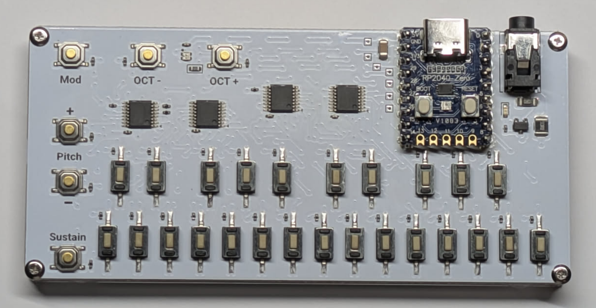
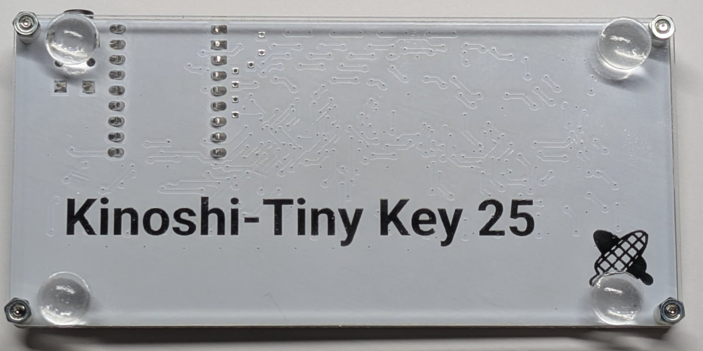

# Kinoshi-Tiny Key 25
[日本語の説明はこちら](./README.ja.md)

----

## What is this?

- A small MIDI controller, 106 mm x 50 mm.
- Has USB MIDI (In/Out) and legacy MIDI (Out, 3.5 mm Type A).
- It has:
  - Octave switches +/-
  - Modulation switch
  - Pitch Bend switches
  - Sustain switch

- The source code and schematics are open. You can change them as you need.
- More features are planned in future firmware updates.

## What's in the box
- DIN-TRS adapter cable (Type A)
- Rubber feet (use them if you need them)

## How to use
- Power it with a USB Type-C cable. Connect it to a mobile battery, a PC/Mac, etc.
- USB MIDI works with the standard OS driver. No extra driver is needed.

## Settings editor
- A web-browser-based editor lets you change the MIDI channels, velocity, button behavior and more.
- https://kinoshi-tiny-key-25.editor.kinoshita-lab.com/
- Requires firmware v1.1.0 or later.
